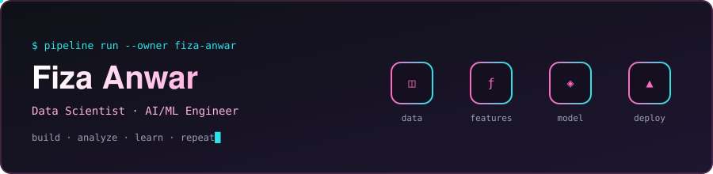

<div align="center">



<br/>

[](www.linkedin.com/in/fiza-anwar--)
[](mailto:fizaanwar02@gmail.com)
[](https://github.com/FizaAnwar)

</div>

---

> **This profile is a model card.** Instead of a list of skills, I document myself the way I'd document a model: what I'm built for, what I was trained on, how I perform, and where I fail.

```yaml
---
model_id:      fiza-anwar
version:       2026.1
pipeline_tag:  data-scientist, ML/AI, MLOPS, data-analytics
languages:     [python, sql, matlab, english]
library_name:  curiosity
base_model:    DHA Suffa University (BS Data Science, 2026)
training_runs: [10Pearls, PIA, Bytewise]
license:       open-to-opportunities
status:        deployed, still learning
---
```

## 🧬 About Me

A data science professional who builds **practical systems where data, models, automation and business insight meet.** I like taking raw data all the way to something people can use: **predictive models, live dashboards and deployable web apps.**

Particular interests: **MLOps, explainable AI, and ML for real business problems.**

## 🚀 Currently Working on 

- Building practical **Machine Learning and AI applications**
- Developing **predictive models and data analytics solutions**
- Working with **MLOps and automated ML workflows**
- Exploring **model deployment and explainable AI**
- Building interactive **data dashboards and ML web applications**
- Strengthening my skills in **Data Science & AI/ML**

## 🎯 Usage

| ✅ Works well for | 🚫 Out of scope |
| --- | --- |
| **EDA & statistical analysis**: distributions, correlations, hypothesis testing | Conclusions drawn without checking the data first |
| **Feature engineering** & data cleaning on messy real-world data | Data leakage between train and test sets |
| **Regression & classification** with proper model comparison (ANN vs 1D CNN, tree-based vs neural) | Reporting one metric and calling it done |
| **Time-series forecasting** (e.g. real-time AQI) | Models that only run in one notebook |
| **Model evaluation**: train/test splits, regression metrics, error analysis | Black-box predictions nobody can explain |
| **Explainable AI** with SHAP | Dashboards without a decision behind them |
| **Dashboards** (Power BI, Tableau) that answer a business question | Manual retraining every week |

## ⚙️ Workflow

```text
 1. FRAME        business question → target variable → success metric
        │
 2. COLLECT      scraping · SQL (MySQL, PostgreSQL) · APIs · CSV/Excel
        │
 3. CLEAN        missing values · outliers · types · duplicates   (Pandas, NumPy)
        │
 4. EXPLORE      EDA · distributions · correlations · hypothesis tests
        │         (Matplotlib, Seaborn, Plotly)
 5. ENGINEER     feature creation · encoding · scaling · feature store (Hopsworks)
        │
 6. MODEL        baseline ──► Scikit-learn / XGBoost ──► ANN · 1D CNN (Keras)
        │
 7. EVALUATE     train/test split · regression metrics · model comparison
        │
 8. EXPLAIN      SHAP: which features drive each prediction, and why
        │
 9. DELIVER      Streamlit app · Power BI / Tableau dashboard
        │
10. AUTOMATE     GitHub Actions ──► retrain ──► version model ──► update app
                      ▲                                │
                      └────────── new data ◄───────────┘
```

## 📊 Projects

### 🌫️ Smart AQI Predictor
Automated ML pipeline for **real-time air-quality forecasting**: data ingestion, feature engineering, training, model versioning and automated model updates.
**Stack:** `Python` · `Scikit-learn` · `Hopsworks` · `GitHub Actions` · [Repo](https://github.com/FizaAnwar/Smart-AQI-Forecast)

### 🧠 Multimodal AI Intelligence System
Integrates **text, images and structured data** for context-aware decision making.
**Stack:** `Python` · `TensorFlow/Keras` · `NLP` · `Computer Vision` · [Repo](https://github.com/FizaAnwar/FYP-M.S.S.D-Final)

### 🔍 Explainable ML Web App
Interactive app that explains each prediction with **real-time SHAP values**, bringing interpretability closer to end users.
**Stack:** `Python` · `Streamlit` · `SHAP` · `Scikit-learn` · [Repo](https://github.com/FizaAnwar/ExplainableMLapp)

### 🏠 RealEstateML
End-to-end **California house-price prediction**: preprocessing, EDA, regression, and a comparison of **ANN vs 1D CNN** architectures.
**Stack:** `Python` · `TensorFlow/Keras` · `Scikit-learn` · `Pandas` · `NumPy`

### 📈 Data Analytics & BI
EDA, data cleaning, operational analytics and interactive **Power BI** dashboards that give stakeholders self-service visibility.
**Stack:** `Python` · `Pandas` · `Power BI` · `Tableau` · `SQL`

## ## 🧰 Tech Stack

**Languages**<br/>


**Machine Learning & Deep Learning**<br/>


**Data Analysis**<br/>


**Visualization & BI**<br/>


**MLOps & Deployment**<br/>


**Databases**<br/>


**Environments**<br/>


**Core concepts:** `EDA` · `Statistical Modeling` · `Hypothesis Testing` · `Feature Engineering` · `Model Evaluation` · `Data Cleaning` · `Predictive Analytics`

## 🏋️ Training History

| Run | Role | What I learned / shipped |
| --- | --- | --- |
| **10Pearls** | Data Science Intern | Hopsworks Feature Store, production-oriented ML workflows, model tracking, data-quality work alongside senior data scientists |
| **Bytewise** | Data Science Intern | Built and deployed a real-time AQI forecasting pipeline with GitHub Actions automation and Hopsworks versioning |
| **PIA** | Data Science Intern | Data scraping, cleaning and EDA on operational data; Power BI dashboards for stakeholders |

## 🎓 Pre-training

**BS Data Science** · DHA Suffa University · 2026

## 📜 Checkpoints (Certifications)

- 🧠 **Prompt Engineering**: Andrew Ng / DeepLearning.AI
- 🎓 **CS50**: Harvard University
- 🐍 **Python Smart Pro**: Aptech Education
- 📘 **Introduction to Python**: DataCamp
- 🗄️ **Introduction to SQL**: DataCamp

## ⚠️ Limitations & Known Biases

- Strong bias towards automating anything I have to do twice.
- Will ask "but can we explain this prediction?" in every meeting.
- Performance degrades without a clean dataset (and chai ☕).
- Tends to overfit on side projects when a deadline is far away.
  
## 📈 GitHub Activity

<div align="center">


<picture>
  <source media="(prefers-color-scheme: dark)" srcset="https://raw.githubusercontent.com/FizaAnwar/FizaAnwar/output/github-snake-dark.svg">
  <source media="(prefers-color-scheme: light)" srcset="https://raw.githubusercontent.com/FizaAnwar/FizaAnwar/output/github-snake.svg">
  
</picture>

</div>

## 🛣️ Next Training Run

- [ ] Deepen **MLOps**: monitoring, drift detection, CI/CD for models
- [ ] Go further with **deep learning & explainable AI**
- [ ] Ship more **deployed apps**, not just notebooks
- [ ] Land a role where data meets real business problems

## 📌 Learning & Interests

Currently strengthening my foundations in **Machine Learning · Deep Learning · AI · Data Analytics · MLOps · Explainable AI**.

I'm particularly interested in building practical systems where **data, machine learning models, automation, and business insights come together to solve real-world problems.**

## 📚 Citation

```bibtex
@misc{anwar2026,
  author = {Fiza Anwar},
  title  = {Turning Data into Insights, Models, and Practical AI Solutions},
  year   = {2026},
  url    = {https://github.com/FizaAnwar}
}
```

---


## 💡 Random Dev Quote

<div align="center">


</div>

---

<div align="center">

### 🤝 Let's Connect and Build Something Amazing!

**Open to internships, collaborations and interesting data problems.**

`inference_endpoint:` [fizaanwar02@gmail.com](mailto:fizaanwar02@gmail.com)

> Turning data into insights, models, and practical AI solutions.
>
> **Build. Analyze. Learn. Repeat. 🚀**

</div>


